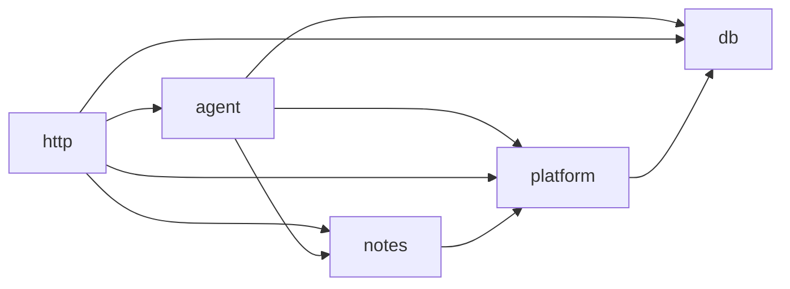

# Architecture

The service is a small Hono API in front of one Mastra agent. Hono owns HTTP: auth, limits, errors, and streaming. Mastra owns the agent loop: the model, tools, memory, guardrails, and approvals.

## How a message runs

1. **Auth.** `src/http/auth.ts` sends the caller's bearer token to the notes API's `GET /v1/users/me`, as the [contract](notes-api.md#auth) describes. A valid token gives a user ID and a notes client bound to that token. Results are cached for 30 seconds.
2. **Limits.** The request passes the per-IP and per-user rate limits, then the daily token budget in `src/agent/budget.ts`.
3. **Run.** `src/agent/runs.ts` opens a run row. A thread has at most one open run, so two messages never interleave.
4. **Agent.** `agent.stream()` runs with the thread as memory, the user's notes client in the request context, and the step, output, and time limits.
5. **Guardrails.** Input processors strip control characters, then Haiku 5.5 checks the newest message for prompt injection. A flagged message ends the run as `blocked`.
6. **Tools.** The model calls tools in `src/agent/tools.ts`. They call the notes API with the caller's token, and the call is cancelled if the run ends first. `updateNote` and `deleteNote` pause for approval first.
7. **Relay.** `src/agent/relay.ts` turns Mastra chunks into server-sent events, and records each model call's tokens.
8. **Settle.** The run ends as `completed`, `awaiting_approval`, `blocked`, `failed`, or `aborted`. A paused run is saved as `awaiting_approval` before the client gets `approval-required`, so it can approve at once.

An approval resumes the same run from its Postgres snapshot, so it works after a restart or on another instance.

## Modules

| Path | Does |
|---|---|
| `src/index.ts` | Starts the server and the cleanup timer, and on shutdown aborts open runs before it exits |
| `src/app.ts` | Builds the Hono app: middleware, routes, and error handling |
| `src/config.ts` | Parses and validates the environment |
| `src/http/` | Auth, rate limits, validation, and the routes |
| `src/agent/notes-assistant.ts` | The agent: instructions, model, tools, memory, and guardrails |
| `src/agent/context.ts` | What every agent call carries, and `runOptions()`, which the API and the evals both call |
| `src/agent/tools.ts` | The notes tools |
| `src/agent/mastra.ts` | Mastra wiring: Postgres storage, logs, and tracing |
| `src/agent/runs.ts` | Run rows: one open run per thread, approvals, and stale runs |
| `src/agent/budget.ts` | Daily token budgets |
| `src/agent/relay.ts` | Mastra stream to client events, plus token accounting |
| `src/notes/client.ts` | The notes API client |
| `src/platform/` | Problem Details errors, the logger, and the hourly cleanup |
| `src/db/` | Drizzle schema, client, and migrations |
| `evals/` | Eval cases and the runner |
| `test/fake-anthropic.ts` | A fake Messages API for tests |

## Dependencies

Imports point one way, so the agent can run without HTTP, as the evals do:

`src/index.ts`, `src/app.ts`, and `src/db/migrate.ts` wire everything together, so they may import anything. Only `src/http/` imports Hono. `test/unit/architecture.test.ts` fails on any other import.

## Data

Postgres holds two schemas:

- `public`: the app's tables, managed by Drizzle. `runs`, `token_usage`, and `rate_limits`.
- `mastra`: Mastra's tables for threads, messages, and approval snapshots. `src/db/migrate.ts` creates and upgrades them.

The app connects as `agent_app`, which can read and write rows but can't change the schema. Migrations run as the owner.

Notes live in the notes API, not here. The agent never touches the notes database.
