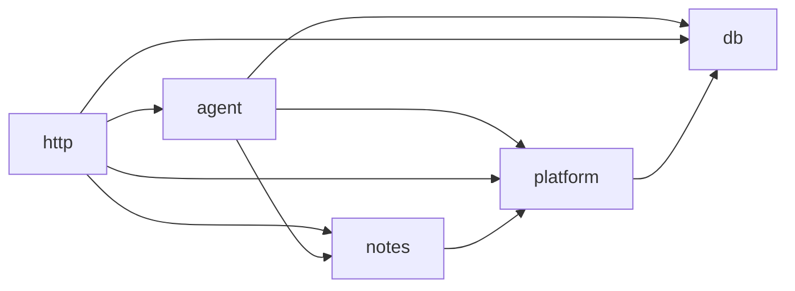

# Architecture

The service is a small Hono API in front of one Mastra agent. Hono owns HTTP: auth, limits, errors, and streaming. Mastra owns the agent loop: the model, tools, memory, guardrails, and approvals.

## How a message runs

1. **Auth.** `src/http/auth.ts` sends the caller's bearer token to the notes API's `GET /v1/users/me`, as the [contract](notes-api.md#auth) describes. A valid token gives a user ID and a notes client bound to that token. Results are cached for 30 seconds.
2. **Limits.** The request passes the per-network and per-user rate limits.
3. **Run.** In one transaction, `src/agent/runs.ts` claims the `Idempotency-Key`, if any, and opens a run row, and `src/agent/budget.ts` reserves the run's tokens and checks the user's concurrent runs, as [decision 008](decisions/008-reserve-run-tokens-before-streaming.md) explains. A thread has at most one open run, so two messages never interleave.
4. **Agent.** `agent.stream()` runs with the thread as memory, the user's notes client in the request context, the step, output, time, and token limits, and prompt caching.
5. **Guardrails.** Input processors strip control characters, then Haiku 5.5 checks the newest message for prompt injection. A flagged message ends the run as `blocked`, and a check that fails ends it as `failed`, as [decision 009](decisions/009-fail-closed-when-the-guardrail-fails.md) explains. `src/agent/guardrail-usage.ts` records the check's tokens and failures for the run, as [decision 007](decisions/007-count-guardrail-tokens-per-run.md) explains.
6. **Tools.** The model calls tools in `src/agent/tools.ts`. They call the notes API with the caller's token and the trace context, and the call is cancelled if the run ends first. `updateNote` and `deleteNote` pause for approval first.
7. **Relay.** `src/agent/relay.ts` turns Mastra chunks into server-sent events, and each finished step moves its tokens from the reservation to the day's usage.
8. **Settle.** The run's finish reason sets its status, as [decision 010](decisions/010-report-why-a-run-stopped.md) explains, and the run frees what's left of its reservation. A paused run is saved as `awaiting_approval` before the client gets `approval-required`, so it can approve at once.

An approval claims the paused run, reserves what's left of its token limit, then resumes the same run from its Postgres snapshot, so it works after a restart or on another instance. If the budget can't cover the rest, the run ends instead, which frees the thread.

## Modules

| Path | Does |
|---|---|
| `src/index.ts` | Starts the server and the cleanup timer, and on shutdown drains, waits for runs, then aborts the rest |
| `src/instrumentation.ts` | Starts the OpenTelemetry SDK for traces and metrics, when `OTEL_EXPORTER_OTLP_ENDPOINT` is set |
| `src/app.ts` | Builds the Hono app: middleware, routes, the OpenAPI document, and error handling |
| `src/config.ts` | Parses and validates the environment |
| `src/http/` | Auth, rate limits, idempotency, the OpenAPI routes and docs, health, and error handling |
| `src/agent/notes-assistant.ts` | The agent: instructions, model, tools, memory, and guardrails |
| `src/agent/context.ts` | What every agent call carries, and `runOptions()`, which the API and the evals both call |
| `src/agent/tools.ts` | The notes tools |
| `src/agent/mastra.ts` | Mastra wiring: Postgres storage, logs, and tracing |
| `src/agent/runs.ts` | Run rows: one open run per thread, idempotency keys, approvals, and stale runs |
| `src/agent/budget.ts` | Daily token budgets and run reservations, split into agent and guardrail tokens |
| `src/agent/guardrail-usage.ts` | The guardrail's model, which reports its tokens and failures for each run |
| `src/agent/relay.ts` | Mastra stream to client events, token accounting, and how a run ended |
| `src/agent/retention.ts` | Deletes threads nobody used for `THREAD_RETENTION_DAYS` |
| `src/notes/client.ts` | The notes API client |
| `src/platform/` | Problem Details errors, public IDs, the logger, metrics, shutdown, and the hourly cleanup |
| `src/db/` | Drizzle schema, client, and migrations |
| `evals/` | Eval cases and the runner |
| `test/fake-anthropic.ts` | A fake Messages API for tests |

## Dependencies

Imports point one way, so the agent can run without HTTP, as the evals do:

`src/index.ts`, `src/app.ts`, and `src/db/migrate.ts` wire everything together, so they may import anything. Only `src/http/` imports Hono. `test/unit/architecture.test.ts` fails on any other import.

## Data

Postgres holds two schemas:

- `public`: the app's tables, managed by Drizzle. `runs`, with each run's status, stop reason, and reserved and spent tokens; `token_usage`; `idempotency_keys`; and `rate_limits`.
- `mastra`: Mastra's tables for threads, messages, and approval snapshots. `src/db/migrate.ts` creates and upgrades them.

The app connects as `agent_app`, which can read and write rows but can't change the schema. Migrations run as the owner.

Notes live in the notes API, not here. The agent never touches the notes database.
